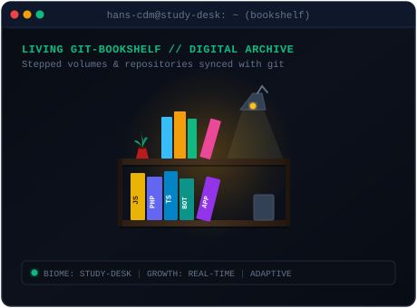
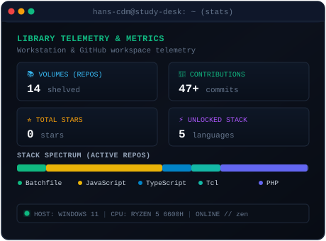

<div align="center">


</div>

---

### 💻 System Specs & Environment

```text
████████   ████████      hans-cdm@workstation
████████   ████████     ----------------------
████████   ████████     OS: Windows 11 Home (64-bit)
████████   ████████     Host/CPU: AMD Ryzen 5 6600H (6C/12T)
                        Memory: 16 GB DDR5
████████   ████████     Shell: PowerShell 5.1 / Windows Terminal
████████   ████████     Active Stack: JavaScript | TypeScript | Tcl | PHP
████████   ████████     Specialization: [Masa Eksplorasi / Belum Terspesialisasi]
████████   ████████     Growth Status: Continuous Evolution 🌱
```

---

### 📊 Activity & Telemetry

<div align="center">
<table border="0" width="100%">
  <tr>
    <td width="50%" align="center" valign="top">
      
    </td>
    <td width="50%" align="center" valign="top">
      
    </td>
  </tr>
</table>

<br/>


</div>

---

### 📈 Contribution Landscape

<div align="center">


</div>

---

### 📚 The Bookshelf (Active Repositories)

<!-- REPOS-LIST:START -->
| 📦 Project / Buku | 📝 Fokus / Deskripsi | ⚡ Bahasa Utama | ⭐ Stars | 🕒 Terakhir Push |
| :--- | :--- | :---: | :---: | :---: |
| **[`hans-cdm / hitori`](https://github.com/hans-cdm/hitori)** | New Base Bot WhatsApp | 🟨 JavaScript | `—` | `2mo ago` |
| **[`hans-cdm / LAGI`](https://github.com/hans-cdm/LAGI)** | *Belum ada deskripsi* | 🟨 JavaScript | `—` | `7mo ago` |
| **[`hans-cdm / Server-Reset-Manager-for-seedloaf`](https://github.com/hans-cdm/Server-Reset-Manager-for-seedloaf)** | Repository for https://replit.com/@hpra0097/Server-Reset-Manager | 🟨 JavaScript | `—` | `7mo ago` |
| **[`hans-cdm / botfor`](https://github.com/hans-cdm/botfor)** | *Belum ada deskripsi* | 🔷 TypeScript | `—` | `7mo ago` |
| **[`hans-cdm / huh`](https://github.com/hans-cdm/huh)** | *Belum ada deskripsi* | 📜 Tcl | `—` | `7mo ago` |
| **[`hans-cdm / Mine-Bot`](https://github.com/hans-cdm/Mine-Bot)** | Repository for https://replit.com/@HanungPeramono/Mine-Bot | — | `—` | `7mo ago` |
| **[`hans-cdm / fot`](https://github.com/hans-cdm/fot)** | *Belum ada deskripsi* | — | `—` | `7mo ago` |
| **[`hans-cdm / bot`](https://github.com/hans-cdm/bot)** | *Belum ada deskripsi* | — | `—` | `7mo ago` |
| **[`hans-cdm / belajar-freelance`](https://github.com/hans-cdm/belajar-freelance)** | *Belum ada deskripsi* | — | `—` | `1y ago` |
| **[`hans-cdm / tugas-pak-rahmat`](https://github.com/hans-cdm/tugas-pak-rahmat)** | *Belum ada deskripsi* | 🐘 PHP | `—` | `1y ago` |
| **[`hans-cdm / tugas-pak-fajar`](https://github.com/hans-cdm/tugas-pak-fajar)** | *Belum ada deskripsi* | 🐘 PHP | `—` | `1y ago` |
| **[`hans-cdm / tugas-4`](https://github.com/hans-cdm/tugas-4)** | tugas pak rahmat | 🐘 PHP | `—` | `1y ago` |
<!-- REPOS-LIST:END -->

---

### 🛠️ Unlocked Stack & Tooling

> *Konsep Rak Buku: Hanya bahasa dan perkakas yang sudah pernah dibuatkan project nyata yang akan terbuka di rak ini.*

```
┌── [UNLOCKED LANGUAGES]
│   ├── JavaScript       ── Modern asynchronous services, bots, and web interactivity (3 repo)
│   ├── TypeScript       ── Type-safe development and scalable architecture (1 repo)
│   ├── Tcl              ── Scripting, tooling, and command execution (1 repo)
│   └── PHP              ── Server-side web scripting and backend endpoints (3 repo)
│
└── [SYSTEM & WORKSTATION]
    ├── Hardware       ── AMD Ryzen 5 6600H with Radeon Graphics • 16 GB RAM
    ├── Operating Sys  ── Microsoft Windows 11 Home (x64)
    ├── Terminal Shell ── PowerShell 5.1 / Windows Terminal
    └── Tooling Core   ── Git, GitHub CLI (gh), Node.js, Python
```

---

### 📬 Kontak & Koneksi

<div align="center">

[](mailto:hpra0097@gmail.com)
[](https://github.com/hans-cdm)

</div>
